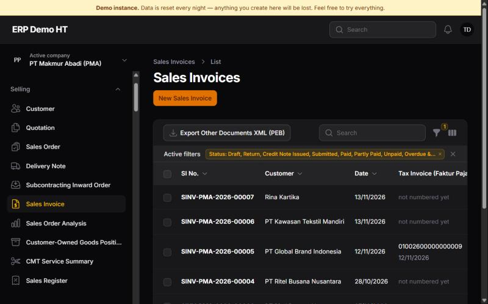
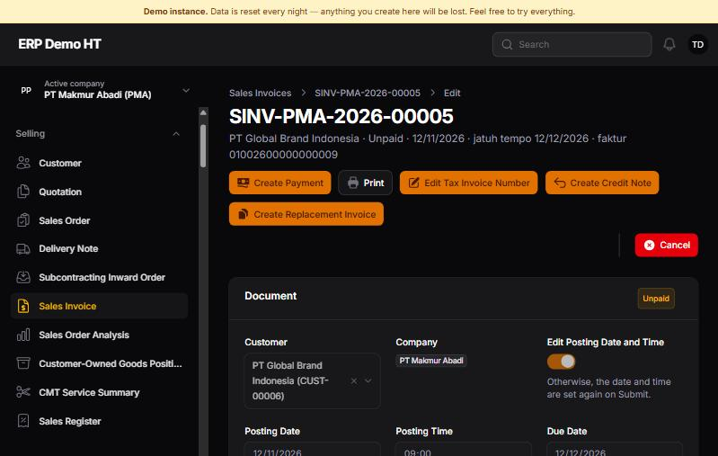
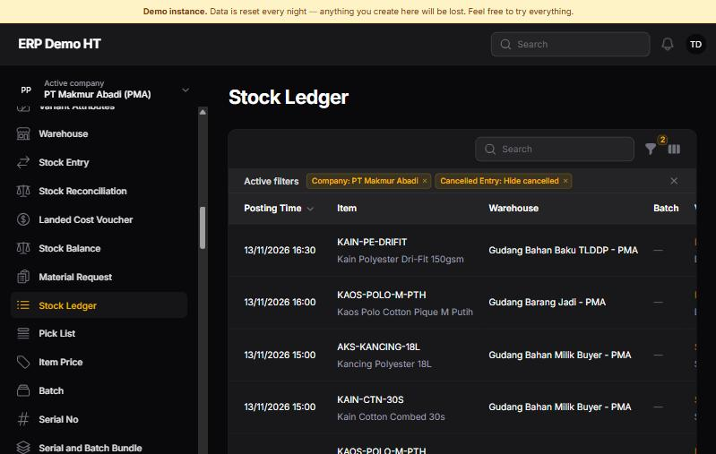
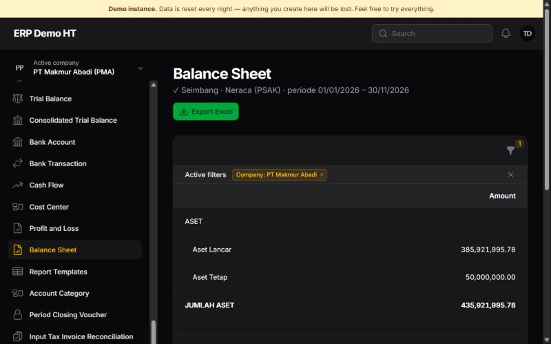

# Laravel ERP: Manufacturing, Inventory & Accounting

A full-featured ERP for small and mid-sized manufacturers, built with **Laravel 13** and **Filament 5**. It covers
buying, selling, inventory, manufacturing, subcontracting, quality and double-entry accounting in one system, with
an optional localization layer for Indonesian tax and customs.

This repository is a **showcase**: it describes the product and links to a live demo. The source code is private.
Code walkthroughs are available on request for prospective clients (see [Contact](#contact)).

The document model (draft → submitted → cancelled, with ledger postings on submit) is inspired by ERPNext. The code
is an independent Laravel implementation, not a fork. ERPNext is a trademark of Frappe Technologies.

**Live demo:** https://erp.haritjahjo.com  
Guest login: `demo@haritjahjo.com` / `Demo1234`  
The demo company is fictional (PT Makmur Abadi, a garment manufacturer). All data is reset every night at
02:00 WIB (19:00 UTC), so feel free to create, submit and cancel documents.

| | |
|---|---|
|  |  |
| **Sales invoices**: document numbers, customers, tax invoice numbers | **Sales invoice**: payment, print, credit note and tax invoice actions |
|  |  |
| **Stock ledger**: every movement per item and warehouse | **Balance sheet**: balanced check, Indonesian accounting standard (PSAK) layout |

*The interface is in English (each user can switch to Indonesian). The demo company's data, such as item, warehouse and account names, is in Indonesian, and a few labels are still being translated.*

---

## What it does

### Selling and buying
- Quotations, Sales Orders, Delivery Notes, Sales Invoices
- Material Requests, Purchase Orders, Purchase Receipts, Purchase Invoices
- Payment Entries, payment terms, item prices, taxes and charges templates
- Accounts Receivable and Accounts Payable ageing

### Inventory
- Multi-warehouse stock with a **stock ledger**: every movement is recorded as a ledger entry, and stock levels
  are derived from it rather than edited directly
- Stock Entries (receipt, issue, transfer, manufacture), Stock Reconciliation, pick lists
- Batch and serial number tracking, landed cost vouchers
- Stock balance and stock ledger reports

### Manufacturing and planning
- Bills of Materials, BOM explorer, routings, operations, workstations
- Production Plans, Work Orders and Job Cards
- Material requirements planning (MRP) and demand forecasts
- Subcontracting in both directions: sending work out, and receiving work from customers (CMT)
- Quality inspections with templates and parameters

### Accounting
- Double-entry general ledger, journal entries, cost centers, bank accounts and bank transactions
- Trial Balance, Balance Sheet, Profit and Loss, Cash Flow, consolidated trial balance
- Configurable financial report templates, period closing
- Tax withholding categories

### Platform
- **Multi-company**, with modules (e.g. manufacturing, subcontracting) switched on per company
- **Audit trail** of user actions
- **Ledger preview** before submitting a document, so users see the accounting and stock impact first
- Excel exports processed in the background through queues, and PDF print formats
- REST API (Laravel Sanctum tokens, rate-limited) for posting journal entries from other systems

### Indonesian localization (optional layers)
- VAT (PPN), e-Faktur / Coretax exports, withholding tax (PPh 21/22/23/4(2)), amounts in words
- Customs (bea cukai): bonded zone documents (BC forms), IT Inventory reports, CEISA payloads, bonded logistics
  centre (PLB) workflows

---

## Architecture

The codebase is organised in layers, so country- or industry-specific features never leak into the core:

| Layer | Contents |
|---|---|
| **L1 Core** | documents, ledgers, valuation, buying/selling, payments, financial reports, manufacturing, subcontracting |
| **L2 Indonesia** | tax rules, e-Faktur, withholding, local formats |
| **L3 Customs** | bonded zone and customs documents |
| **L4 Industry** | reserved for industry-specific features |

Dependencies point one way only (L3 → L2 → L1). The core never references the upper layers, and an automated
architecture test enforces this on every CI run. Upper layers plug into the core through contracts, events and
model extension points rather than conditionals in core code.

Other design choices:
- Money and quantities use exact decimal arithmetic, never floats
- One timezone setting drives both PHP and the database session, so reports and posting dates never drift
- Business logic lives in domain services; the Filament admin layer stays thin

---

## Quality

- **About 2,000 automated tests** covering ledger postings, valuation, document workflows, reports and layer
  boundaries
- CI on every push (PHP 8.3 + MariaDB 10.11), plus a release pipeline on PHP 8.5 + MySQL 8.4
- Deterministic demo data, verified by tests

## Operations

The live demo runs the same production setup intended for client instances:
- Laravel Forge on an Ubuntu 26.04 VPS, zero-downtime deployments
- Redis for cache, sessions and queues; a supervised queue worker and the Laravel scheduler
- **Encrypted (AES-256) daily database backups** to S3-compatible object storage, with retention rules, failure
  email alerts and a health check command
- A guarded nightly demo reset that refuses to run outside the demo environment

---

## Tech stack

PHP 8.3+ · Laravel 13 · Filament 5 · Livewire · MySQL 8 / MariaDB 10.11 · Redis · Tailwind CSS ·
spatie/laravel-permission · spatie/laravel-activitylog · spatie/laravel-backup · Laravel Excel · DomPDF · Sanctum

---

## Contact

Built and maintained by **Hari Tjahjo**, a PHP/Laravel developer based in Indonesia (GMT+7).
Available for ERP, inventory and back-office projects, Laravel/Filament development, and server setup and migrations.

[Hire me on Upwork](https://www.upwork.com/freelancers/~01ed9b76e858cdc8bd) · hello@haritjahjo.com

---

© 2026 Hari Tjahjo. All rights reserved. The text and images in this repository may not be reused without permission.
